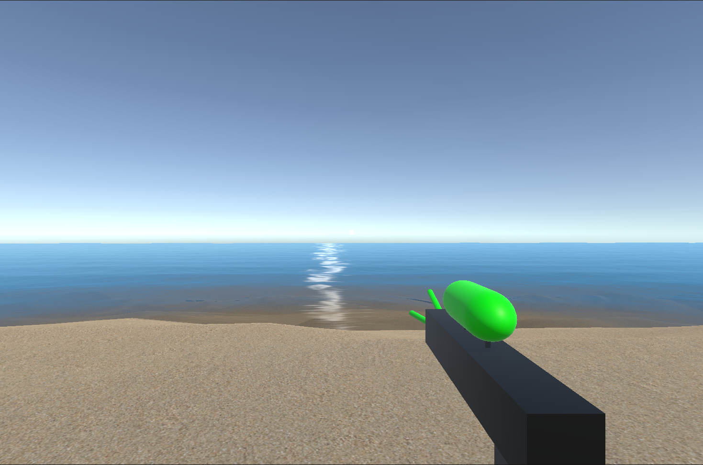
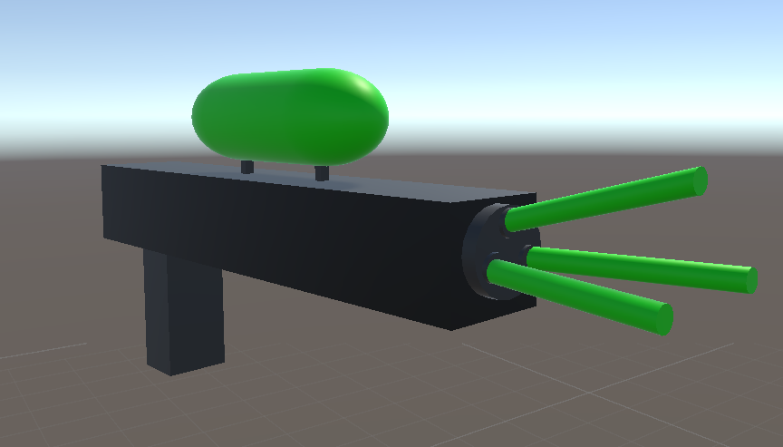
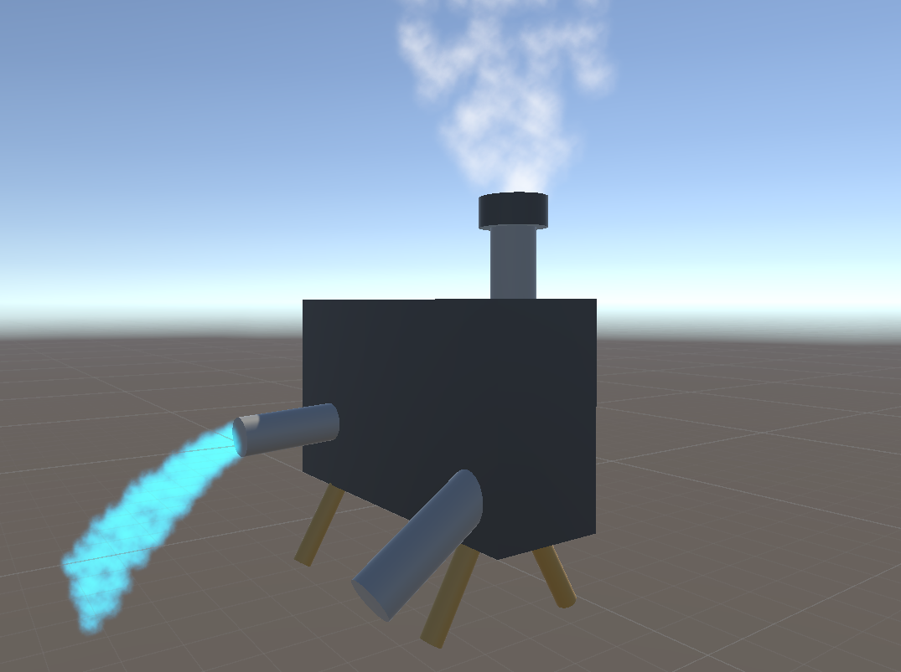
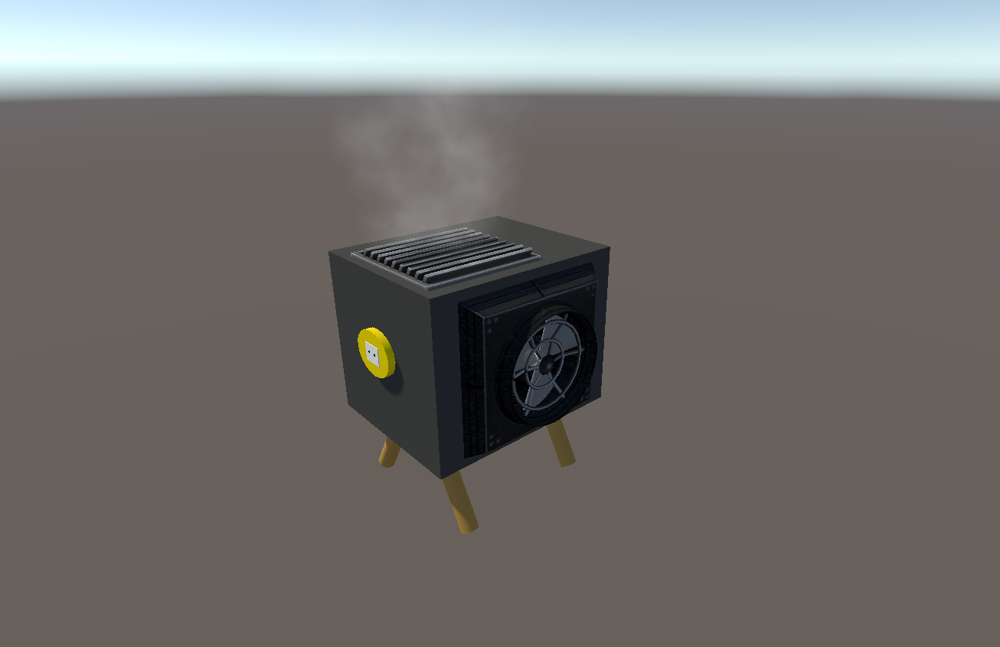
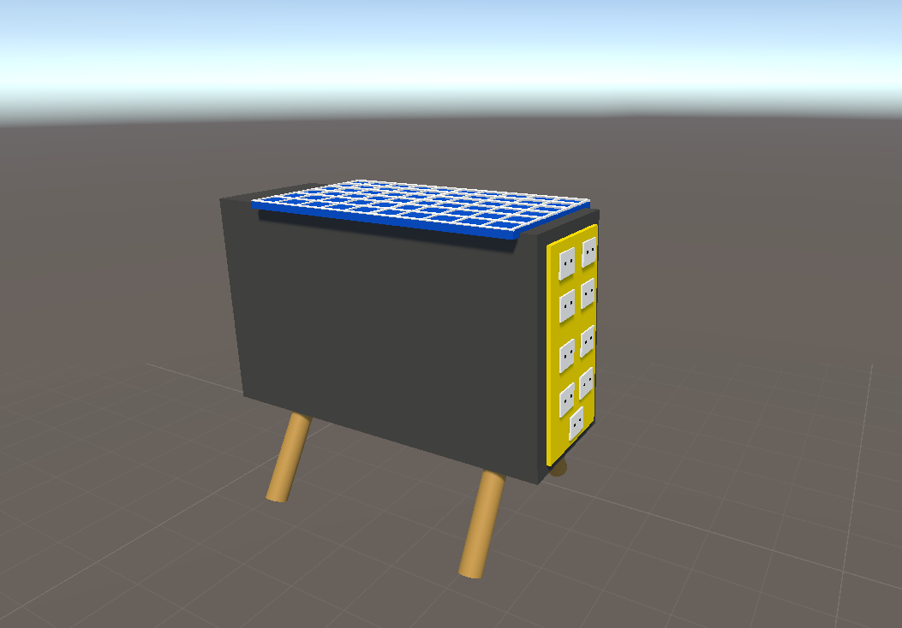

# Çevre Dostu (Eco-Friendly) — 3D Environmental Cleanup & Recycling Game


> **[Türkçe açıklama için aşağı kaydırın / Scroll down for Turkish documentation](#türkçe-özet-2021-lise-proje-arşivi)**

A 3D first-person **environmental cleanup, recycling, and solar-powered automation game** built solo in **Unity (C#)** between **November 2021 and January 2022** during **9th grade (age 14–15)** for a high school project course — **written completely before the AI coding assistant era**.

Inspired by the **2021 Sea of Marmara mucilage (*müsilaj*) crisis**, the game combines FPS trash-recycling mechanics, renewable-energy base building, survival/inventory systems, and periodic environmental awareness cards into a packaged Windows desktop build (with an **Inno Setup 6** installer).

---

## Screenshots

| Beach & Recycling Gun View | Recycling Gun Model |
| :---: | :---: |
|  |  |

| Mucilage Cleaner (`6,000 TL`) | Air & Gas Cleaner (`12,000 TL`) | Solar Generator (`10,000 TL`) |
| :---: | :---: | :---: |
|  |  |  |

---

## Core Gameplay & Features

- **Recycling Gun & Upgrade Progression (`GunController`, `SmoothGun`)**
  - Raycast-based trash detection and conversion for 5 waste types (`Pet Şişe` 24 TL, `Cam Şişe` 37 TL, `Kağıt Uçak` 14 TL, `Paslı Konserve Kutusu` 76 TL, `Konserve Kutusu` 98 TL).
  - Weapon energy consumption/regeneration, muzzle particle burst, audio feedback, mouse-look sway (`Lerp`), and 4 upgrade tiers extending raycast range (`10f` to `15f`).
- **Eco-Machine Building & Solar Power Grid (`BuildController`, `MusilajCleaner`, `Jenerator`, `Button3D`)**
  - Ghost-preview placement system (`MusilajPre`, `GasPre`, `JeneratorPre`).
  - **Mucilage Cleaner (`6,000 TL`)**: Snaps strictly to coastal `Socket` points and cleans spawned sea mucilage (`10–100 TL` reward per cycle).
  - **Air / Gas Cleaner (`12,000 TL`)**: Placed on valid ground layers; filters air pollution (`10–50 TL` reward per cycle) with rotating fan animation (`ChangeRot`).
  - **Solar Generator (`10,000 TL`)**: Supplies electricity to machines within a `35f` radius.
  - Right-click (`Mouse1`) on placed machines opens a 3D/UI upgrade dialog (`10,000 * level` TL).
- **Event-Driven Inventory & Hunger Survival (`Assets/ItemSystem/`)**
  - Hunger bar (`food`) drains over time and disables sprinting when depleted.
  - Modular item system using `IInteraction`, abstract `ScriptableObject` (`BaseItem` -> `ConsumableItem`), and C# `delegate`/`event` observers (`CamInteraction.itemCanGet`, `CanGet.gotItem`).
  - Stackable UI slots (`InventoryController`, `InventoryButton` via `IPointerClickHandler`) supporting left-click consume (`+45` hunger) and right-click world drop.
- **Surface-Aware Footsteps & Audio (`CheckerGroundName`, `PlayerMovement`, `Starter`, `Starter1`)**
  - `Physics.CheckSphere` ground detection (`GrassLayer`, `SandLayer`, `AsphaltLayer`) playing terrain-matched footsteps (trimmed in Audacity) with randomized pitch (`0.70–1.18`), ambient guitar tracks, volume sliders, and dynamic camera `farClipPlane` distance slider.
- **Environmental Awareness Cards (`RandomGiveInfo`)**
  - Every `120s`, pauses movement/cursor and displays Q&A cards (*"BİLGİ ZAMANI"*) covering pollution causes, climate impacts, Marmara industrialization, and recycling solutions.
- **Persistence (`Saver_Loader` & `PlayerPrefs`)**
  - Saves player position, currency, weapon level, settings, placed machine positions/levels, and active waste/mucilage counts across sessions.

---

## Controls

| Key / Input | Action |
| :--- | :--- |
| `W A S D` / Arrows | Move |
| `Left Shift` | Sprint *(requires hunger > 0)* |
| `Space` | Jump |
| `Left Click (Mouse0)` | Recycle targeted trash / Use inventory item |
| `Right Click (Mouse1)` | Open machine upgrade menu / Drop inventory item |
| `E` | Pick up food item |
| `F` | Confirm machine placement |
| `M` | Toggle Market panel |
| `I` | Toggle Inventory panel |
| `Esc` | Toggle Options / Pause menu |

---

## Project Structure

```text
Assets/
├── ItemSystem/              # Interface, ScriptableObject items, event-based pickup & inventory UI
│   ├── BaseItem.cs
│   ├── CamInteraction.cs
│   ├── CanGet.cs
│   ├── ConsumableItem.cs
│   ├── IInteraction.cs
│   ├── InventoryButton.cs
│   └── InventoryController.cs
├── Scripts/                 # Player controller, ground audio check, weapon, menu & trash metadata
│   ├── CheckerGroundName.cs
│   ├── GunController.cs
│   ├── MouseLook.cs
│   ├── MoveBullet.cs
│   ├── PlayerMovement.cs
│   ├── Starter.cs
│   ├── Starter1.cs
│   └── TrashInfo.cs
├── Scenes/                  # StartScreen.unity & GameScene.unity
├── MusilajCleaner/          # Custom-assembled machine prefabs, preview prefabs & UI icons
├── TrashS/                  # Recyclable trash prefabs
├── BuildController.cs       # Ghost preview placement & machine upgrade raycast
├── Button3D.cs              # Machine upgrade confirmation UI handler
├── Jenerator.cs             # Solar power generation & radius-based device power distribution
├── MusilajCleaner.cs        # Mucilage & gas cleaner automation + PlayerPrefs serialization
├── RandomGiveInfo.cs        # Periodic environmental Q&A modal
└── Saver_Loader.cs          # Session state restoration
```

---

## Retrospective & Technical Self-Review

This repository intentionally preserves the **authentic 2021 high school codebase** (converted only from Windows-1254 to UTF-8 so Turkish comments and strings render cleanly on GitHub). Reviewing it years later highlights both early strengths and classic beginner pitfalls:

### What Worked Well (Solo, Age 14–15, Pre-AI)
- **Clean decoupling in `ItemSystem`**: Combining `IInteraction`, abstract `ScriptableObject` definitions, and C# `delegate/event` subscriptions (`OnEnable`/`OnDisable`) avoided tight coupling between camera raycasting, world pickups, and inventory UI.
- **Complete end-to-end game loop**: Built everything from async scene loading and custom machine 3D assemblies to surface-specific foley audio and an **Inno Setup 6** Windows installer.

### Known Technical Debt & Bugs Found in Review
- **`PlayerPrefs.Save()` in `Update()`** (`Starter.cs`, `Starter1.cs`): Persists volume every frame instead of hooking `Slider.onValueChanged`.
- **Per-frame `FindGameObjectsWithTag()`** (`MusilajCleaner.cs`, `Jenerator.cs`): Scans the entire scene every frame instead of maintaining a central registry/manager.
- **`PlayerMovement.ChangeMoney()` `level > 4` bug**: `UpgradeWeapon()` caps at level `4`, so the promised 2x income multiplier at max level never triggers (and would also double purchase costs if it did).
- **`GunController` & `CamInteraction` edge cases**: `Random.Range(0, 1)` (exclusive integer upper bound) always returns `0`; `myPower` lacks an upper clamp; raycast misses don't always hide the prompt text.
- **Power grid & lifecycle bugs**: `Jenerator` increments `connectedDevices` without ever decrementing it and ignores `MusilajCleaner.usingElectric`; `MusilajCleaner` contains a non-existent `OnSceneQuit()` Unity method and spams coroutines when `musilajList.Length == 0`; `Saver_Loader` + `Start()` counters can drift if `OnApplicationQuit()` isn't reached.
- **Minor bugs**: `MoveBullet.cs` uses `=` instead of `-` (`hitPoint = transform.position`); `MouseLook.cs` multiplies mouse delta by `Time.fixedDeltaTime` inside `LateUpdate()`; `GoMainMenu()` calls `Application.Quit()`; a `developerMode` `PlayerPrefs` money cheat remained in `Update()`.

---

## Opening in Unity

1. Clone this repository.
2. Open the project in **Unity Hub** using **Unity `2021.2.2f1`** *(original build version, `2022.3.8f1` is currently recorded in `ProjectSettings/ProjectVersion.txt`)*.
3. Open `Assets/Scenes/StartScreen.unity` and press **Play** (or check `File > Build Settings` where `StartScreen` and `GameScene` are configured).

*(Note: Unused demo folders from standard asset packs and a leftover archive file were excluded when publishing this repository to keep the clone lightweight; original custom scripts, scenes, prefabs, terrain data, and used environment/water assets are preserved.)*

---

## Türkçe Özet (2021 Lise Proje Arşivi)

Bu proje, **Kasım 2021 – Ocak 2022** tarihleri arasında **9. sınıfta (14–15 yaşımdayken)**, henüz yapay zekâ kodlama asistanlarının olmadığı dönemde lise proje hazırlama dersi için **Unity (C#)** ile sıfırdan geliştirdiğim **3D Çevre Temizleme, Geri Dönüşüm ve Yenilenebilir Enerji Yönetimi** oyunudur.

2021 yılında gündemde olan **Marmara Denizi müsilaj sorunu**, çevre kirliliği ve temiz enerji farkındalığını oyun mekaniklerine dönüştürür:
- **Geri Dönüşüm Silahı:** Haritadaki pet şişe, cam şişe, kağıt uçak ve konserve kutularını enerji harcayarak dönüştürür, TL kazanır ve silahı 4 seviyeye kadar yükseltirsin.
- **Otomasyon & Güneş Enerjisi:** Marketten (`M`) **Müsilaj Temizleyici**, **Hava/Gaz Temizleyici** ve **Güneş Enerjili Jeneratör** alıp haritaya (`F`) kurarsın; makineleri sağ tıkla geliştirebilirsin.
- **Hayatta Kalma & Envanter:** Zamanla azalan açlık barını dünyadan topladığın yiyeceklerle (`E`) ve `ScriptableObject` + `event` tabanlı envanterle (`I`) yönetirsin.
- **Ses & Eğitsel Bilgi Kartları:** Bastığın zemine (kum, çim, asfalt) göre değişen ayak sesleri ve her 120 saniyede bir çıkan **"BİLGİ ZAMANI"** çevre bilinci kartları içerir.

> Orijinal 2021 kodları yalnızca GitHub'da Türkçe karakterlerin düzgün görünmesi için UTF-8'e çevrilmiş, oyun mantığına dokunulmadan tarihsel portfolyo arşivi olarak paylaşılmıştır. Yukarıdaki *Retrospective* bölümünde ise bugün geriye dönüp baktığımda gördüğüm teknik borçlar ve bug'lar özetlenmiştir.
